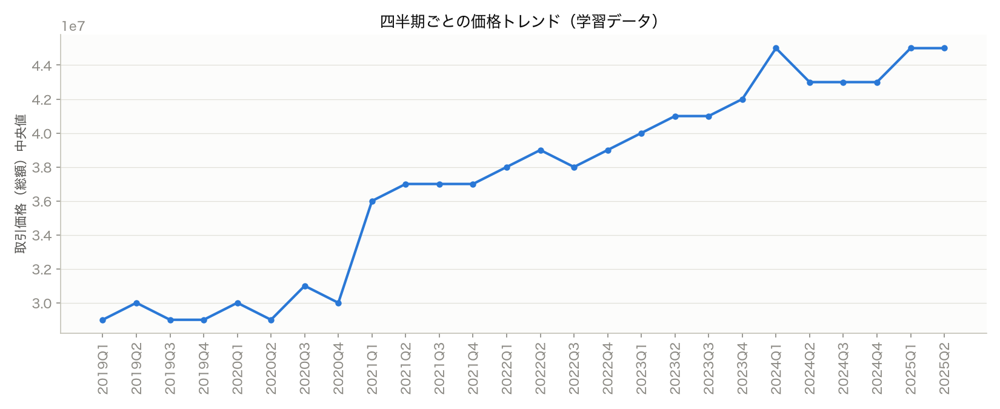
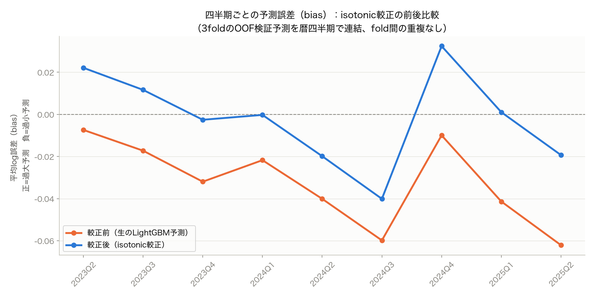

# Nanjoの取り組み説明資料

`Nanjo/my-project-exploration`ブランチでの試行錯誤を、人に説明する用にまとめたもの。詳細ログは[`docs/experiments.md`](../experiments.md)、まとめレポートは[`docs/report-nanjo.md`](../report-nanjo.md)、チームパイプラインとの比較は[`docs/comparison-with-team-pipeline.md`](../comparison-with-team-pipeline.md)を参照。

## 1. 何をやったか（一言で）

「学習データ（2019〜2025年前半）から、未来（2025年後半〜2026年）のマンション価格を予測する」という課題に対して、①まず動くパイプラインを作り、②その精度をちゃんと測れる検証方法を作り、③誤差を分析して、④見つかった弱点をピンポイントで直す、という順番で進めた。

## 2. なぜ検証方法から説明すべきか

一番伝えたいポイントはここ。最初は「駅データを足す」「カテゴリを分解する」のように、思いつく施策を先に試していた。でも検証が単一のホールドアウト（1回の答え合わせ）だったため、「効果が0.001改善した」と思っても、それが本物の改善なのか、たまたまのブレなのか判断できなかった。

これに気づいて、**3fold時系列CV**（過去で学習して、直後の3四半期を当てる、を3回繰り返して平均を取る）を作り直した。すると、fold間のスコアのブレ（標準偏差0.0047〜0.0057）が、それまで追いかけていた「改善」の差（0.0006程度）より大きいと分かった。つまりそれまでの細かい改善判定は、そもそも測定不能なノイズを追いかけていた。

ここから「検証をまず信用できる状態にしてから、施策を評価する」という順番に切り替えた（※これはチームが決めた方針と、独立に同じ結論に辿り着いていた）。

## 3. ベースのモデル

LightGBM（勾配ブースティング木）1本。`取引価格`を`log1p`変換して学習（評価指標RMSLEが対数誤差なので、対数で学習すると指標と直結する）。特徴量は、面積・築年数・駅距離・取引時期を数値化したもの、間取りを「部屋数＋L/D/K/Sの有無」に分解したもの、市区町村名・地区名・最寄駅などの生カテゴリ、地区名・最寄駅をtarget encoding（カテゴリごとの平均価格を数値特徴量にしたもの、リーク防止のためout-of-foldで計算）したもの。

## 4. 誤差分析で何を見つけたか（ここが核心）

頑健な検証ができたことで、初めて「どこで外しているか」を信頼して見られるようになった。残差（予測と実際の差）を軸別に集計すると:

- **直近の四半期になるほど、予測が実際より安くなる**（過小予測が拡大）。木モデルが、学習データに無い未来の時期を「一番新しい時期と同じ」として扱ってしまうため。相場が上がり続けている局面では、これが構造的に効いてくる
- **安い物件は高く予測し、高い物件は安く予測する**という、両端で逆方向のクセがある（regression to the mean、木モデルが極端な値を苦手とする典型的な現象）

実際の価格トレンドと見比べると分かりやすい:

2021年以降はっきり右肩上がりで、特に2024Q1・2025Q1〜Q2で急な上昇が見える。

## 5. isotonic較正とは何か（チームに評価された施策）

**考え方**: モデルの生の予測をそのまま使わず、「この予測値が出た時、実際はだいたいいくらだったか」という対応表（較正曲線）を作って、予測を後から補正する。

**やり方**: 学習データの中にもう1つ、時系列の区切り（内側ホールドアウト）を作る。そこで「予測値→実際値」の関係にisotonic回帰（単調に増加する曲線）を当てはめる。「予測が安い側に出た時は実際はもう少し高い」「予測が高い側に出た時は実際はもう少し安い」という補正曲線ができる。これを本番の予測に適用する。

**効果**: 4で見つけた両端のズレを直接補正する。較正の前後で、四半期ごとの誤差（bias）がどう変わったかが下のグラフ。

オレンジ（較正前）はほぼ常にマイナス側＝過小予測が続き、特に2024Q3・2025Q2で大きく外れている。青（較正後）はゼロ線にかなり近づいている。価格トレンドのグラフと並べると、「相場が上がる局面で生モデルは追いつけず安く予測しがちだったが、較正でそれが補正された」というストーリーが伝わる。

※2024Q3→2024Q4の境目で両方の線が跳ねているのは、2つのfold（学習範囲の異なるモデル）の継ぎ目。fold毎に別々の較正曲線を学習しているための自然な現象で、バグではない。

**結果**: CV 0.20462 → 0.20118（3fold全部で改善、方向が一貫していたのでノイズではなく本物と判断）。

## 6. 効かなかったものも説明できるようにしておく（聞かれやすい）

- **駅データ（乗降客数・緯度経度）**: 位置情報はすでに`地区名`等のカテゴリが十分表現していて、重複情報だった（藤瀬さんのQ14と独立に同じ結論）
- **ハイパラ調整**（num_leaves等1軸ずつ）: どれもCVのブレの範囲内で、有意な改善なし。ただし`cat_smooth`は試していなかった（チーム側の発見、要追試）
- **疑似建物ID**（同じ地区・駅・築年・構造の組を疑似的な建物とみなす）: 残差が同じ建物内で似ているという統計的証拠（シャッフル検定でchanceより8〜12ポイント高いR²）は得られたが、target encodingとして実装すると効果が出なかった。ほとんどのグループが1〜3件しかなく、out-of-fold計算だとスカスカになりすぎたため
- **2段階学習**（物件評価と市場トレンドを別モデルに分ける）: 発想自体は誤差分析で正しいと裏付けられたが、実装（時間情報を丸ごと落とす）が粗く、isotonic較正という軽量な形に置き換えたら成功した

## 7. 一言でまとめるなら

AIに丸投げでモデルを作らせるのではなく、**検証方法自体を疑い、作り直し、それで初めて見えた誤差パターンに対してピンポイントで手を打った**。isotonic較正はその象徴的な成果。
