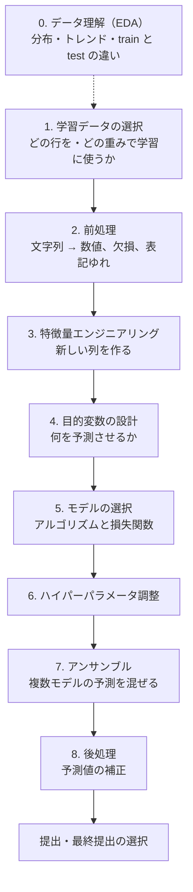

# 精度改善のワークフロー

学習から予測までの流れと、各工程で精度改善のために打てる手をまとめる。担当を決めるときや、進捗を確認するときの地図として使う。

## 全体の流れ

1〜8 のどの変更も、検証（時系列 CV）のスコアで良し悪しを判定する。検証は改善の対象ではなく、固定して使う物差し（`docs/validation.md`）。

## 工程ごとの打ち手

期待度は、このコンペの性質から見たチームの見立て。実験の結果で更新する。

| # | 工程 | 打ち手の例 | 期待度 | コードの場所 |
|---|---|---|---|---|
| 0 | データ理解 | 四半期ごとの価格推移、価格情報区分（取引価格 / 成約価格）ごとの価格差、train と test の分布の違い | — | `notebooks/`（未作成） |
| 1 | 学習データの選択 | 古い期間を捨てる・重みを下げる。外れ値（特殊な事情の取引、極端な価格）を除く。test に多い成約価格情報を重く見る | 中 | — |
| 2 | 前処理 | 「戦前」「30分～60分」などの置き換え値の見直し、全角の統一、駅名の括弧表記の統一 | 小 | `src/data.py` |
| 3 | 特徴量 | **場所**：地区・駅ごとの㎡単価（target encoding） **物件**：間取りの分解（部屋数・LDK の有無）、容積率×面積 **集約**：駅・地区ごとの取引件数や平均築年数 **外部データ**：駅の乗降客数など（規約の範囲内） | 大 | `src/features/` |
| 4 | 目的変数 | ㎡単価を予測して面積を掛け戻す。時間トレンドを引いてから学習し、予測時に足し戻す | **大** | `src/train.py` |
| 5 | モデルの選択 | CatBoost（カテゴリに強い）、XGBoost、ニューラルネット。損失関数を外れ値に強い Huber にする | 中 | `src/train.py` |
| 6 | ハイパーパラメータ | learning_rate、num_leaves、min_data_in_leaf、正則化、feature_fraction。Optuna で探索 | 小〜中 | `params` |
| 7 | アンサンブル | seed を変えたモデルの平均、異なるモデルの加重平均、stacking | 中 | — |
| 8 | 後処理 | test の時期に合わせた価格水準の補正（トレンドの延長分を掛ける） | 中 | — |

### サンプルの重み（工程 1）

学習のときに、行ごとに「どれだけ重視するか」を数値で指定するもの。モデルは各行の誤差に重みを掛けてから合計し、それを小さくするように学習する。重み 2 の行は同じ行を 2 回入れたのとほぼ同じ扱いで、重み 0 の行は除外したのと同じ。

- 新しい取引を重く見る：古いデータを捨てずに、test に近い時期の取引を優先できる
- 成約価格情報を重く見る：train では 45%、test では 67% なので、train の構成を test に近づけられる

重みは学習のときだけ付け、CV のスコアは重みなしで計算する。

## 進め方の原則

- **4 と 8 がこのコンペの肝**：決定木は、学習期間より高い価格水準を予測できない。価格が上がり続けているので、トレンドの扱い（4 で引いて 8 で戻す、または 8 で補正する）が特徴量より効く可能性がある
- **前の工程から固める**：1〜4 で「何を学習させるか」が固まらないうちに 6・7 をしても、土台が変わるたびにやり直しになる。6・7 は後半に回す
- **0 を先に見る**：特に「四半期ごとの価格推移」と「train と test の違い」は、1・4・8 の方針を決める材料になる
- **2 の前処理は共通部分**：変えると全員の結果が変わるので、PR で合意して変える。個人で試したい前処理は、3 の特徴量として「直した列を新しく作る」形で試す

## 実験の仕組みの対応状況

`src.train.run_experiment` で、どの工程を試せるか。

| # | 工程 | 対応 | 補足 |
|---|---|---|---|
| 1 | 学習データの選択 | ❌ | 行の除外や重みを渡す口がない |
| 2 | 前処理 | △ | `src/data.py` を変える（共通部分） |
| 3 | 特徴量 | ○ | 価格を使う特徴量（target encoding）は fold ごとの計算が必要で、未対応 |
| 4 | 目的変数 | ❌ | `log1p(価格)` で固定 |
| 5 | モデル | ❌ | LightGBM で固定 |
| 6 | パラメータ | ○ | `params` で渡す |
| 7 | アンサンブル | ❌ | 検証予測（OOF）と test 予測を保存していない |
| 8 | 後処理 | ❌ | 予測値を補正する口がない |

❌ の工程は、`run_experiment` に差し替え口（`select`・`fold_features`・`target`・`model`・`postprocess`）を足し、予測を保存するようにして対応する予定。どの差し替え口も、省略すれば今と同じ動きになる。
